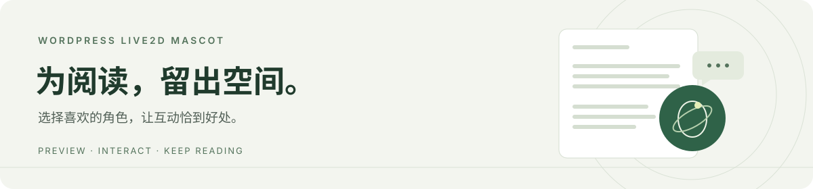
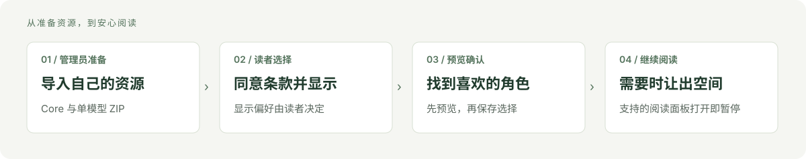

<picture><source media="(max-width: 600px)" srcset="docs/assets/hero-small.svg"></picture>

<h1 align="center">WordPress Live2D Mascot</h1>

<strong>给 WordPress 添一位可切换、可互动，也懂得让出阅读空间的看板娘。</strong>

Character previews · Local favorites · Reading-aware interaction

  <a href="https://github.com/wzf2000/wordpress-live2d-mascot/releases/tag/v3.9.0">下载 3.9.0</a> ·
  <a href="#开始使用">开始使用</a> ·
  <a href="docs/index.md">使用文档</a> ·
  <a href="docs/TROUBLESHOOTING.md">常见问题</a> ·
  <a href="docs/index.md#english-entry-points">English</a>

把自己有权使用的 Live2D 角色带到 WordPress：访客可以预览、切换、收藏角色，播放动作与表情，或让角色说一句。阅读对话框、支持的评论面板打开时，看板娘会暂停并让出空间。

插件支持独立安装及 PageNest 明暗主题，后台、个人资料和前台控件提供中文与英文。**安装包不含 Cubism Core 或模型**；管理员需从官方或其他有权来源自行取得并导入资源。

## 你能用它做什么

| 选一位喜欢的角色 | 让互动恰到好处 | 按自己的习惯摆放 |
| --- | --- | --- |
| 搜索、收藏、预览后确认；从收藏中随机挑选，或找回最近使用的角色。 | 播放动作、表情与快捷互动；本地台词可选自动、仅主动或静默。 | 用画布外的移动柄拖动、左右停靠、调整大小，也支持键盘移动与复位。 |

- **阅读时留出空间。** 支持的对话框／评论面板打开或页面进入后台时暂停；恢复后沿用原显示偏好。
- **按模型已有能力互动。** 可选轻柔视线跟随、已有命中区域绑定；站点工具可主动接入操作完成通知。
- **偏好由读者选择。** 默认保存在本机；登录后可主动读取或保存账号的角色、收藏和布局，遇到冲突明确选择。
- **资源由管理员管理。** 支持角色配置、同 ID 更新、上一版回退、停用与回收站、可选缩略图，以及只读容量报告和本地诊断。
- **按需开启更多体验。** 手机显示需管理员允许与读者单独开启；偶尔闲聊默认关闭；透明 PNG 需管理员逐角色核对许可后开启。

<picture><source media="(max-width: 600px)" srcset="docs/assets/reading-flow-small.svg"></picture>

原创流程示意，不包含模型素材或实际界面截图。

## 开始使用

**[下载安装包：wordpress-live2d-mascot-3.9.0.zip](https://github.com/wzf2000/wordpress-live2d-mascot/releases/download/v3.9.0/wordpress-live2d-mascot-3.9.0.zip)**

1. 在 WordPress 后台 **插件 → 安装插件 → 上传插件**，安装并启用上面的 ZIP。
2. 打开 **设置 → Live2D Mascot**，从 [Live2D 官方 SDK 下载页](https://www.live2d.com/en/sdk/download/web/)自行取得 **Web 5 R5 Core**，上传 `live2dcubismcore.min.js` 并确认使用权。当前仅接受固定版本的已核验文件。
3. 从[官方样例](https://www.live2d.com/en/learn/sample/)或其他有权来源准备**单个 Cubism model3 模型的运行 ZIP**，导入并填写角色 ID、名称、署名与来源。具体文件结构见[模型 ZIP 准备](docs/INSTALL.md#准备模型-zip)。
4. 在桌面前台点击 **显示看板娘 → 同意条款并显示**，打开 **互动** 检查画面。切换角色时先预览，再确认使用。

首次导入默认不设置欢迎或招呼动作，可在 **角色管理 → 编辑** 中选择。完整步骤、资源限制和升级方法见[安装与资源准备](docs/INSTALL.md)。

后台安装请使用完整插件 ZIP；`-source.zip` 与 GitHub 自动生成的 **Source code** 用于开发。可用发行附件 [SHA256SUMS](https://github.com/wzf2000/wordpress-live2d-mascot/releases/download/v3.9.0/SHA256SUMS) 核对下载。

## 使用条件

| 项目 | 要求 |
| --- | --- |
| 服务器 | PHP **8.2+**、ZipArchive、可写的 WordPress uploads；缩略图处理另需 GD |
| 浏览器 | 支持 WebGL；系统或浏览器的“减少动画”设置会抑制显示 |
| 资源 | 指定 **Web 5 R5 Core** 与有权在本站使用的 Cubism model3 运行模型 |
| 已验环境 | 真实 CI 固定 WordPress **7.1.3**、PHP **8.2 / 8.5**；浏览器自动测试使用合成资源 |

移动端默认关闭。模型显示效果与实体设备表现需在自己的站点检查；上述环境不表示最低 WordPress 版本要求，也不代表所有模型、手机或真实 GPU 均已验证。采样方法见[设备指南](docs/DEVICE_SAMPLING.md)。

## 文档与支持

| 入口 | 内容 |
| --- | --- |
| [安装与资源准备](docs/INSTALL.md) | 安装、Core、模型 ZIP、署名、升级与服务器要求 |
| [互动与偏好](docs/INTERACTIONS.md) | 台词、快捷互动、移动停靠、账号偏好、PNG 和手机显示 |
| [常见问题与维护](docs/TROUBLESHOOTING.md) | 无法显示、导入失败、角色恢复、容量盘点与诊断 |
| [开发与站点集成](docs/DEVELOPMENT.md) | 构建、测试、发布约定、阅读暂停与同页 API |
| [版本更新](https://github.com/wzf2000/wordpress-live2d-mascot/releases) | 本版和历史发行说明、安装包与校验和 |

遇到问题可[提交 issue](https://github.com/wzf2000/wordpress-live2d-mascot/issues)，说明插件版本、WordPress／PHP／浏览器版本、操作步骤与错误提示。诊断报告可由管理员主动下载；分享前请自行核对内容与资源许可。

## 许可与资源来源

自有代码采用 **[GPL-2.0-or-later](LICENSE)**，包含针对指定 Web 5 R5 的组合附加许可；Framework 与着色器保留各自条款。

公开仓库、安装包和源码包均不附带 Core、模型、贴图、动作或表情素材。维护者按收到的 Live2D 官方回复，引导用户自行取得并导入资源。管理员须满足对应素材的使用条件、署名与来源要求；导入后供前台访问的资源是公开文件。该发行方式不表示官方认证或额外授权。详见[发行与许可说明](docs/DISTRIBUTION.md)。
